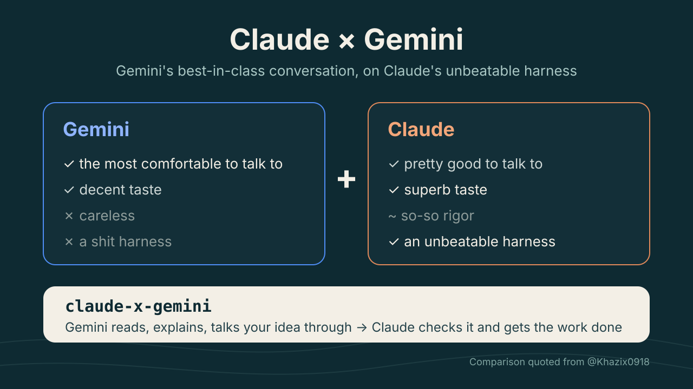
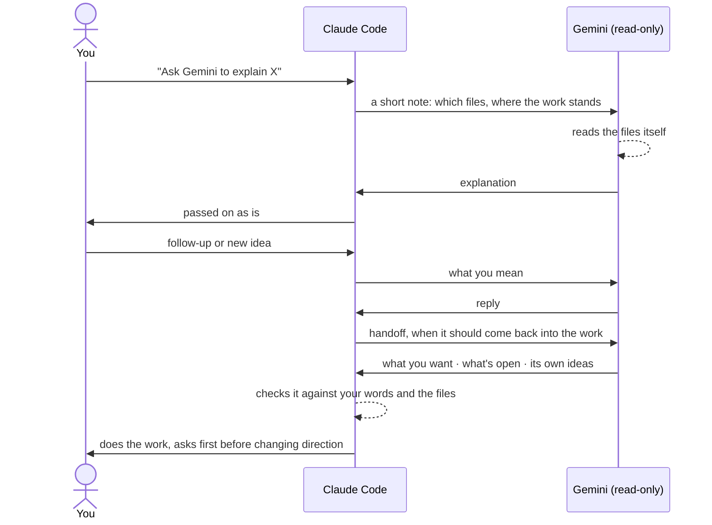

<p align="center">
  
</p>

<p align="center">
  <b>Gemini talks with you. Claude gets the work done.</b><br>
  A Claude Code plugin that puts Gemini, the model that's nicest to talk to, next to Claude, the best harness.
</p>

<p align="center">
  <a href="#install-in-30-seconds"><b>Install in 30 seconds</b></a> ·
  <a href="#what-you-can-ask">What you can ask</a> ·
  <a href="#how-it-works">How it works</a> ·
  <a href="README.zh-CN.md">中文</a>
</p>

---

> Gemini = the most comfortable model to talk to + decent taste + careless + a shit harness<br>
> Claude = pretty good to talk to + superb taste + so-so rigor + an unbeatable harness
>
> — [@Khazix0918 on X](https://x.com/Khazix0918/status/2124680457623425334) (translated from Chinese). His answer: put Claude
> in the middle and Gemini beside it as the advisor. This plugin packages that answer.

## Install in 30 seconds

```bash
brew install --cask antigravity-cli   # Google's Antigravity CLI (Gemini CLI no longer serves personal accounts)
agy                                   # once, to sign in with your Google account
```

Then in Claude Code:

```
/plugin marketplace add pursurer/claude-x-gemini
/plugin install claude-x-gemini@claude-x-gemini
```

No marketplace? Copy `skills/claude-x-gemini/` into `.claude/skills/`. It is self-contained (Python 3.9+, macOS or Linux).

## What you can ask

| You say to Claude Code | What happens |
|---|---|
| "Ask Gemini to explain how this repo is organized." | Claude names the files; **Gemini reads them on its own quota** and explains. You get Gemini's answer unedited. |
| "Ask Gemini: why not cache this?" | Claude passes on what you *mean*, with voice-typing slips fixed and context added, and Gemini replies. |
| "OK, get Gemini's handoff." | Gemini says what you want, what is still open, and its own ideas, kept apart. **Claude checks it against your words and the code**, then gets to work. |
| "Get Gemini's own plan for this." | Claude writes its plan; Gemini writes one independently from your words, not Claude's draft. Claude merges them and shows you where they differ. |

It answers in your language. Styles are off unless you ask: `plain` (~80% ASD-STE100), `eli5`, `feynman`, `expert`,
or an interactive `--html` page.

## How it works



These are tools, not a pipeline. Claude uses any of them, in any order, and stops when you have what you need.

## Why it is built this way

- **Gemini reads, Claude doesn't.** Reading is what costs an agent most, so Claude only names the files.
  A related project measured coding delegation: handing over the whole task while the conductor read nothing cost
  ~0.58× a solo run; file-by-file delegation cost 1.33–1.68×
  ([antigravity-for-claude-code](https://github.com/yuting0624/antigravity-for-claude-code)).
- **Claude checks before it acts.** Gemini is careless and sounds sure. In testing it swapped peak and off-peak hours
  with full confidence; Claude's review caught it. Your own words always outrank Gemini's summary.
- **Almost no prompt.** Claude writes to Gemini in its own words; nothing teaches Gemini how to talk. A small blind
  test (one topic, one reader) preferred this over a fixed five-field template. A fixed line stayed only if it
  changed a test result. Three did: list the questions you never answered; keep Gemini's ideas apart from your
  requests; stay read-only and mark guesses.

## What's inside

```
.claude-plugin/                  plugin + marketplace manifests
skills/claude-x-gemini/          one self-contained skill (Agent Skills layout)
  SKILL.md                       the flow, for Claude Code (60 lines)
  scripts/relay.py               explain · say · handoff · models (standard library only)
  assets/handoff.md              the one fixed request to Gemini: a single sentence
  assets/styles/*.md             optional styles, one line each
assets/                          README images
```

Project defaults: put `.claude-x-gemini.md` in your project root (audience, terms, tone); it is added to every
note. Output goes to `.claude-x-gemini/` (set `CLAUDE_X_GEMINI_DIR` to change it).

## Limits and safety

- Gemini runs read-only: no writes, no shell commands. It can read your workspace, and what it reads goes to Google.
- Likely secret files (`.env*`, keys, credentials) are denied by exact path before each run; Antigravity CLI 1.5.16
  ignored glob and regex deny rules in our tests. Search tools were not tested against this.
- Your plan decides your Gemini. In November 2026, student Google AI Pro got only Gemini 3.8 Flash in Antigravity;
  paid Pro and Ultra get Gemini 4 Neon.

## Credits

[@Khazix0918](https://x.com/Khazix0918/status/2124680457623425334) for the model portraits and the
Claude-in-the-middle setup · [Andrej Karpathy](https://x.com/karpathy/status/2105819303471976479) for ~80% ASD-STE100
· [understanding-ladder](https://github.com/ChangWenC/understanding-ladder) for "cut nothing" ·
[antigravity-for-claude-code](https://github.com/yuting0624/antigravity-for-claude-code) for read-only `agy`
settings and measurements · layout after the [Agent Skills spec](https://agentskills.io/specification),
[anthropics/skills](https://github.com/anthropics/skills), [obra/superpowers](https://github.com/obra/superpowers)
and [mattpocock/skills](https://github.com/mattpocock/skills).

## License

[MIT](LICENSE)
