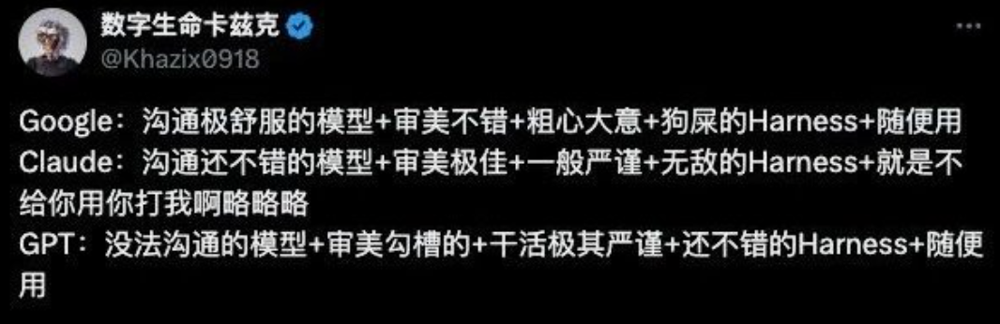
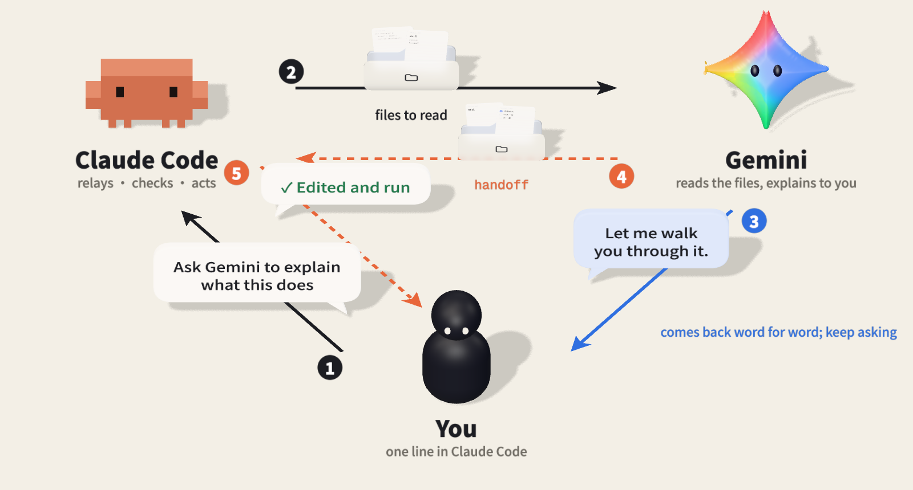

<p align="center">
  <br>
  <sub>The judgement this plugin is built on: <a href="https://x.com/Khazix0918/status/2124680457623425334">@Khazix0918 on X</a></sub>
</p>

<p align="center">
  <b>Gemini talks with you. Claude gets the work done.</b><br>
  A Claude Code plugin that puts Gemini, the model that's nicest to talk to, next to Claude, the best harness.<br>
  <a href="assets/claude-x-gemini-film-zh.mp4">▶ Launch film (26 s, Chinese)</a>
</p>

<p align="center">
  <a href="#what-it-is"><b>What it is</b></a> ·
  <a href="#what-you-get">What you get</a> ·
  <a href="#why-kaziks-judgement-and-how-this-differs">Why</a> ·
  <a href="#install-and-run">Install and run</a> ·
  <a href="README.zh-CN.md">中文</a>
</p>

---

## What it is

You keep working in Claude Code. When you want something explained or an idea talked through, you say
"ask Gemini". Gemini reads the files itself and answers **you**. When you are ready, Gemini tells Claude what you want,
and Claude checks it and does the work.

<p align="center">
  
</p>

These are tools, not a pipeline. Claude uses any of them, in any order, and stops when you have what you need.

| Feature | What it does |
|---|---|
| **Explain** | Claude names the files; Gemini reads them on its own quota and explains. Its answer reaches you unedited. |
| **Talk** | Follow-ups go to Gemini in the same conversation. Claude passes on what you *mean*, with voice-typing slips fixed. |
| **Handoff** | Gemini writes what you want, what is still open, and its own ideas, kept apart. Claude checks it, then works. |
| **Second opinion** | For a big plan, Gemini writes its own plan from your words, not Claude's draft. Claude merges and shows the differences. |
| **Styles** | Off unless you ask: `plain` (~80% ASD-STE100), `eli5`, `feynman`, `expert`, or an interactive `--html` page. |
| **Your language** | Gemini answers in the language you use with Claude. No language is fixed anywhere. |
| **`doctor`** | Checks `agy`, sign-in, quota and models without spending a turn. |

## What you get

- **Claude spends few tokens.** Gemini reads; Claude only names the files. Reading is what costs an agent most.
- **Gemini's own words.** The explanation is not squeezed through a Claude summary on the way to you.
- **A checked handoff.** Gemini is careless and sounds sure. In testing it swapped peak and off-peak hours with full
  confidence; Claude's review caught it. Your own words always outrank Gemini's summary.
- **Gemini never touches your code.** It runs read-only. Likely secret files are denied; in a canary test with planted
  fake secrets, none leaked.
- **Almost no prompt.** Claude writes to Gemini in its own words. A fixed sentence stayed only if it changed a test
  result; four did (list unanswered questions; keep Gemini's ideas apart from your requests; stay read-only and mark
  guesses; write in your language).

## Why: Kazik's judgement, and how this differs

> Gemini = the most comfortable model to talk to + decent taste + careless + a shit harness<br>
> Claude = pretty good to talk to + superb taste + so-so rigor + an unbeatable harness
>
> — [@Khazix0918 on X](https://x.com/Khazix0918/status/2124680457623425334) (translated from Chinese)

His answer: put Claude in the middle and Gemini beside it as the advisor. This plugin is built on that judgement.
It gives each model only the job it is good at:

| | Google's CLI on its own (`agy`) | Gemini as Claude's worker (other `agy` plugins) | **claude-x-gemini** |
|---|---|---|---|
| Who you talk to | Gemini | Claude | **Gemini, for understanding; Claude, for work** |
| Who changes files | Gemini, in Gemini's harness | Gemini, with write grants | **only Claude** |
| Who checks the result | you | Claude | **Claude, against your own words and the files** |
| What reaches Claude | nothing; a separate session | code, a diff, a digest | **what you want, what is open, Gemini's ideas, kept apart** |

- Use **`agy` on its own** if you want Gemini to do the work in Google's harness.
- Use a **worker plugin**, such as [antigravity-for-claude-code](https://github.com/yuting0624/antigravity-for-claude-code),
  to save Claude tokens on implementation.
- Use **claude-x-gemini** to understand a project or talk an idea through with Gemini, while only Claude touches your code.

## Install and run

**1. Install Google's Antigravity CLI and sign in once**

```bash
brew install --cask antigravity-cli   # Gemini CLI no longer serves personal accounts
agy                                   # sign in with your Google account, then quit
```

**2. Install the plugin in Claude Code**

```
/plugin marketplace add pursurer/claude-x-gemini
/plugin install claude-x-gemini@claude-x-gemini
```

No marketplace? Copy `skills/claude-x-gemini/` into `.claude/skills/`. It is self-contained (Python 3.9+, macOS or Linux).

**3. Ask for Gemini**

| You say to Claude Code | What happens |
|---|---|
| "Ask Gemini to explain how this repo is organized." | Gemini reads and explains; you get its answer as is. |
| "Ask Gemini: why not cache this?" | Claude passes on your question with the context Gemini lacks. |
| "OK, get Gemini's handoff." | Gemini says what you want and what is open; Claude checks it and gets to work. |
| "Get Gemini's own plan for this." | Two independent plans; Claude merges them and shows where they differ. |

The plugin runs only when you ask for Gemini, because the files it reads go to Google.

**Optional:** put `.claude-x-gemini.md` in your project root (audience, terms, tone); it is added to every note.
Output goes to `.claude-x-gemini/` (set `CLAUDE_X_GEMINI_DIR` to change it). Something wrong? Run
`python3 skills/claude-x-gemini/scripts/relay.py doctor`.

## Limits and safety

- Gemini runs read-only: no writes, no shell commands. It can read your workspace, and what it reads goes to Google.
- Likely secret files (`.env*`, keys, credentials) are denied by exact path before each run; Antigravity CLI 1.5.16
  ignored glob and regex deny rules in our tests. In a canary test (agy 1.5.16, November 2026) Gemini was asked to
  find planted fake secrets with every tool it had: it had no search or directory-listing tool, its read of `.env`
  was denied, and no value leaked. A later `agy` that adds search tools could change this.
- Your plan decides your Gemini. In November 2026, student Google AI Pro got only Gemini 3.8 Flash in Antigravity;
  paid Pro and Ultra get Gemini 4 Neon.
- Token savings are measured by a related project on coding delegation, not by us on explanations: handing over the
  whole task while the conductor read nothing cost ~0.58× a solo run; file-by-file delegation cost 1.33–1.68×
  ([antigravity-for-claude-code](https://github.com/yuting0624/antigravity-for-claude-code)).

## What's inside

```
.claude-plugin/                  plugin + marketplace manifests
skills/claude-x-gemini/          one self-contained skill (Agent Skills layout)
  SKILL.md                       the flow, for Claude Code
  scripts/relay.py               explain · say · handoff · models · doctor (standard library only)
  assets/handoff.md              the one fixed request to Gemini: a single sentence
  assets/styles/*.md             optional styles, one line each
assets/                          README images
```

## Credits

[@Khazix0918](https://x.com/Khazix0918/status/2124680457623425334) for the model portraits and the
Claude-in-the-middle setup · [Andrej Karpathy](https://x.com/karpathy/status/2105819303471976479) for ~80% ASD-STE100
· [understanding-ladder](https://github.com/ChangWenC/understanding-ladder) for "cut nothing" ·
[antigravity-for-claude-code](https://github.com/yuting0624/antigravity-for-claude-code) for read-only `agy`
settings and measurements · the Gemini and Claude marks in the figure are their owners' trademarks, used only to name the products · launch film: Hong Kong model by Jack M Simmons (CC BY) and MacBook model by jackbaeten (CC BY), both on Sketchfab;
elevation data from Terrain Tiles (Mapzen, NASA SRTM) · layout after the [Agent Skills spec](https://agentskills.io/specification),
[anthropics/skills](https://github.com/anthropics/skills), [obra/superpowers](https://github.com/obra/superpowers)
and [mattpocock/skills](https://github.com/mattpocock/skills).

## License

[MIT](LICENSE)
