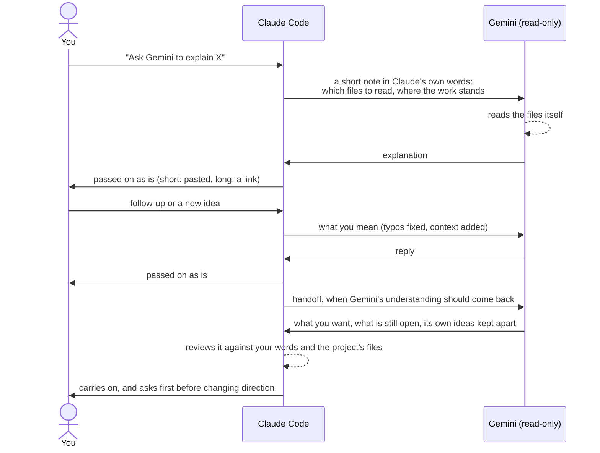

# gemini-relay

**Gemini explains your project to you. You talk it over. Gemini tells Claude Code what you want.**

A Claude Code plugin. Claude Code stays your one window; Gemini, through the
[Antigravity CLI](https://antigravity.google/docs/cli), does the reading and explaining on its own quota.

[中文说明](README.zh-CN.md)

- [Installation (30-second setup)](#installation-30-second-setup)
- [Why this exists](#why-this-exists)
- [How it works](#how-it-works)
- [Usage](#usage)
- [What's inside](#whats-inside)
- [Design choices](#design-choices)
- [Limits and safety](#limits-and-safety)
- [Credits](#credits)

## Installation (30-second setup)

1. Install and sign in to the Antigravity CLI (Gemini CLI no longer serves personal Google accounts):

   ```bash
   brew install --cask antigravity-cli
   agy          # once, to sign in with your Google account
   ```

2. In Claude Code:

   ```
   /plugin marketplace add pursurer/gemini-relay
   /plugin install gemini-relay@gemini-relay
   ```

3. Ask Claude Code: *"Ask Gemini to explain how this project is organized."*

No marketplace? Copy `skills/gemini-relay/` into `.claude/skills/` (project) or `~/.claude/skills/` (user).
The folder is self-contained. Needs Python 3.9+, macOS or Linux.

## Why this exists

### #1: Understanding is the bottleneck

> "LLM output is nearly free; understanding it is the bottleneck."
> — paraphrasing [Andrej Karpathy](https://x.com/karpathy/status/2105819303471976479)

**The problem.** Your agent does the work, and you are left reading reports and diffs you only half follow.
**The fix.** Ask Gemini to explain. A second model, with fresh eyes, reads the files and explains them to you.

### #2: Reading burns your Claude quota

**The problem.** To explain a dozen files, Claude has to read a dozen files.
**The fix.** Claude Code writes Gemini a short note — which files matter, where the work stands — and Gemini reads
them on its own quota. A related project measured coding delegation: handing over the whole task while the
conductor read nothing cost ~0.58× a solo run; file-by-file delegation cost 1.33–1.68×
([antigravity-for-claude-code](https://github.com/yuting0624/antigravity-for-claude-code)).

### #3: Your idea gets lost on the way to the agent

**The problem.** You think out loud — half-formed, voice-typed — and the agent builds something else.
**The fix.** Talk it over with Gemini until it is clear. Gemini then tells Claude Code what you asked for, what is
still open, and keeps its own suggestions apart. Claude Code checks that against your actual words before acting.

## How it works



Three tools, not a pipeline. Claude Code uses any of them, in any order, and stops when you have what you need:

| Tool | What happens |
|---|---|
| **explain** | Claude Code writes Gemini a short note. Gemini reads the files and explains. The answer reaches you unedited. |
| **say** | Your follow-up or new idea goes to the same Gemini conversation, as Claude Code understands it. |
| **handoff** | Gemini tells Claude Code what you want and what is undecided. Claude Code reviews it, then carries on. |

## Usage

Just ask Claude Code, in any language — it answers in yours:

- "Ask Gemini to explain how the auth flow works."
- "Ask Gemini: why not cache this?"
- "Talk this idea over with Gemini." … "OK, get Gemini's handoff."

Options, added only when you ask:

| Option | Effect |
|---|---|
| `--style plain` | about 80% of the way to ASD-STE100 Simplified Technical English; cut nothing |
| `--style eli5` | explain like I'm five, then the precise version |
| `--style feynman` | simple version, where it breaks down, then the repair |
| `--style expert` | dense and precise, no basics |
| `--html` | an interactive HTML page instead of Markdown |
| `--model` | any model your account has |

Add your own style: one line in `skills/gemini-relay/assets/styles/<name>.md`.

**Project defaults:** a `.gemini-relay.md` in your project root (audience, terms to avoid, tone) is added to every
note. Output goes to `.gemini-relay/` (set `GEMINI_RELAY_DIR` to change it).

## What's inside

```
.claude-plugin/              plugin and marketplace manifests
skills/gemini-relay/         one self-contained skill (Agent Skills layout)
  SKILL.md                   the flow, for Claude Code
  scripts/relay.py           explain · say · handoff · models — standard library only
  assets/handoff.md          the one fixed request to Gemini: a single sentence
  assets/styles/*.md         optional styles, one line each
  assets/format-html.md      optional HTML output
```

## Design choices

- **Claude writes freely; nothing teaches Gemini how to talk.** No brief template. Claude Code knows the project
  and the conversation, so it decides what Gemini needs. In a small blind test (one topic, one reader), a
  free-form note beat a fixed five-field brief.
- **Every fixed line earns its place.** Lines were cut unless a test showed they changed the result. Three
  survived: list questions that got no answer (one was dropped before); keep Gemini's ideas apart from your
  requests (they got mixed before); read-only (an attempted write ends Gemini's turn with no answer).
- **Claude Code reviews before it acts.** Gemini can be wrong and sound sure. In testing it swapped peak and
  off-peak hours; the review caught it. Your own words always win over Gemini's summary.

## Limits and safety

- Gemini runs read-only: writes and shell commands are refused. It can read files in your workspace; they go to Google.
- Likely secret files (`.env*`, keys, credentials) are denied by exact path before each run, because Antigravity
  CLI 1.5.16 ignored glob and regex deny rules in our tests. Search tools were not tested against this.
- The Gemini you get depends on your plan. In November 2026, student Google AI Pro plans got only Gemini 3.8 Flash
  in Antigravity; paid Pro and Ultra get Gemini 4 Neon.
- A fast startup failure with no answer (for example a network timeout) is retried once.

## Credits

- [Andrej Karpathy](https://x.com/karpathy/status/2105819303471976479): ~80% ASD-STE100 and HTML explanations.
- [understanding-ladder](https://github.com/ChangWenC/understanding-ladder): "cut nothing" alongside STE.
- [antigravity-for-claude-code](https://github.com/yuting0624/antigravity-for-claude-code): read-only `agy`
  settings, stdin handling, delegation measurements.
- Layout: the [Agent Skills specification](https://agentskills.io/specification),
  [anthropics/skills](https://github.com/anthropics/skills), [obra/superpowers](https://github.com/obra/superpowers),
  [mattpocock/skills](https://github.com/mattpocock/skills).

## License

[MIT](LICENSE)
