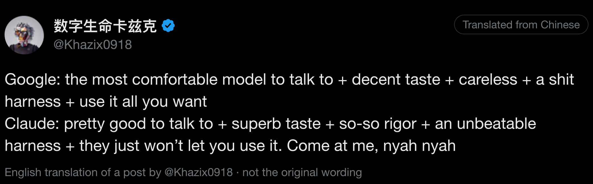

# claude-x-gemini

**A Claude Code plugin. In Claude Code you name Gemini; Gemini reads the files itself and explains things to you; when it is talked through, Claude Code checks the result and does the work.**

**English** · [中文](README.zh-CN.md) · [▶ Launch film (26 s, Chinese)](#launch-film)

<p align="center">
  <br>
  <sub>The starting point is this judgement by <a href="https://x.com/Khazix0918/status/2124680457623425334">@Khazix0918</a> (the picture is our translation; <a href="assets/kazik-post.png">the original post</a> is in Chinese): Gemini is the nicest model to talk to, and Claude has the best harness. This plugin lets each do what it is good at.</sub>
</p>

## In 30 seconds

| | |
|---|---|
| **What it is** | A skill for Claude Code. It calls Gemini through Google's Antigravity CLI (`agy`). |
| **The problem** | You want to understand a project or talk an idea through. Gemini explains well, but you do not want it to touch the code. |
| **Who does what** | Gemini: reads files (read-only), explains, talks with you. Claude Code: relays, checks, edits code, runs commands. |
| **When it runs** | Only when you name Gemini. Reason: the files Gemini reads go to Google. |
| **Requirements** | Claude Code; `agy` signed in with a Google account; Python 3.9+; macOS or Linux. |

## Launch film

26 seconds, with sound. The narration and captions are in Chinese.

https://github.com/user-attachments/assets/5ac844b1-a042-4ad0-8d69-3467ddcdaf71

<sub>If it does not play: [download the mp4](assets/claude-x-gemini-film-zh.mp4).</sub>

## How one request travels

<p align="center">
  
</p>

1. **You say one line.** In Claude Code, name Gemini: "ask Gemini to explain what this does".
2. **Claude Code relays.** It tells Gemini which files to read. It does not read them first.
3. **Gemini answers you.** It reads the files itself. The answer reaches you word for word; Claude does not compress it. You can keep asking.
4. **Gemini writes the handoff.** When it is talked through, Gemini writes three things: what you want, what is still open, and its own suggestions.
5. **Claude Code does the work.** It first checks the handoff against your own words and the files. Then it edits code and runs commands.

Step 3 can repeat as often as you like. The steps are tools, not a pipeline: Claude can use only one of them and can stop at any time.

## Install

**1. Install the Antigravity CLI and sign in once**

```bash
brew install --cask antigravity-cli
```

```bash
agy
```

Sign in with your Google account, then quit. (Gemini CLI no longer serves personal accounts, so this plugin uses `agy`.)

**2. Install the plugin in Claude Code**

```
/plugin marketplace add pursurer/claude-x-gemini
/plugin install claude-x-gemini@claude-x-gemini
```

Without the marketplace: copy `skills/claude-x-gemini/` into your project's `.claude/skills/`. The folder is self-contained.

**3. Check (optional)**

```bash
python3 skills/claude-x-gemini/scripts/relay.py doctor
```

It checks `agy`, the sign-in, the quota and the models. It does not spend a turn.

## Use

Talk to Claude Code. Name Gemini in each request.

| You say | What happens |
|---|---|
| "Ask Gemini to explain how this repo is organized." | **Explain.** Gemini reads the files and explains. Its answer reaches you unedited. |
| "Ask Gemini: why not add a cache here?" | **Talk.** Follow-ups continue in the same conversation. Claude carries your meaning and adds the context Gemini lacks. |
| "OK, get Gemini's handoff." | **Handoff.** Gemini writes what you want, what is open, and its suggestions. Claude checks it, then acts. |
| "Have Gemini write its own plan too." | **Second opinion.** Gemini sees only your words, not Claude's draft. Claude merges the two and tells you where they differ. |

Options:

- **Explanation style** (off unless you ask): `plain`, `eli5`, `feynman`, `expert`, or `--html` for an interactive page.
- **Language**: Gemini uses the language you use with Claude.
- **Project notes**: put `.claude-x-gemini.md` (audience, terms, tone) at the project root. It is added to every request.
- **Output folder**: `.claude-x-gemini/`. Change it with the environment variable `CLAUDE_X_GEMINI_DIR`.

## What you get

- **Claude spends few tokens.** Reading is an agent's largest cost. Here Gemini reads; Claude only names the files.
- **Gemini's own words.** The explanation reaches you without a summary by Claude.
- **A checked handoff.** Gemini is careless and sounds sure. In a test it called the peak hours the half-price hours; Claude's check caught it. Your words always win over Gemini's summary.
- **Gemini cannot touch your code.** It is read-only. Likely secret files are denied.
- **Almost no fixed prompt.** Claude writes to Gemini in its own words. Only four fixed sentences remain; each one changed a test result.

## How it differs

| | Google's CLI (`agy`) alone | Gemini works for Claude (other `agy` plugins) | **claude-x-gemini** |
|---|---|---|---|
| Who you talk to | Gemini | Claude | **Gemini to understand, Claude to get work done** |
| Who edits files | Gemini, in Gemini's harness | Gemini, with write access | **Only Claude** |
| Who checks the result | You | Claude | **Claude, against your words and the files** |
| What comes back to Claude | Nothing; it is another session | Code, diffs, summaries | **What you want, what is open, Gemini's suggestions, kept apart** |

Which one to use:

- You want Gemini to do the work in Google's harness: use `agy` alone.
- You want to save Claude's tokens on coding: use a worker plugin, for example [antigravity-for-claude-code](https://github.com/yuting0624/antigravity-for-claude-code).
- You want to understand a project and talk ideas through with Gemini, and let only Claude touch the code: use claude-x-gemini.

Kazik's words, translated:

> Gemini = the most comfortable model to talk to + decent taste + careless + a shit harness<br>
> Claude = pretty good to talk to + superb taste + so-so rigor + an unbeatable harness

His answer is to put Claude in the middle and seat Gemini beside it as an adviser. This plugin follows that idea.

## Limits and safety

- **Gemini is read-only.** It cannot write files or run commands. The workspace files it reads go to Google.
- **Secret files.** Before each run the plugin denies likely secret files (`.env*`, private keys, credentials) by exact path. Reason: in our tests Antigravity CLI 1.5.16 ignored glob and regex deny rules.
- **Bait test** (agy 1.5.16, November 2026): we planted fake secrets and told Gemini to find them with every tool it has. It has no search or directory-listing tool, reading `.env` was refused, and no value leaked. A later `agy` with a search tool can change this result.
- **The model depends on your plan.** In November 2026 the student Google AI Pro plan has only Gemini 3.8 Flash in Antigravity; paid Pro and Ultra have Gemini 4 Neon.
- **The token figures are not ours.** They come from a related project's measurements on coding tasks: handing over a whole task, with the lead not reading the material, cost about 0.58×; handing over file by file cost 1.33–1.68× ([antigravity-for-claude-code](https://github.com/yuting0624/antigravity-for-claude-code)).

## Quick reference for agents

If you are an agent reading this repository, this section is enough. The full flow is in [`skills/claude-x-gemini/SKILL.md`](skills/claude-x-gemini/SKILL.md).

- **Trigger**: use it only when the human names Gemini. Never call it unasked.
- **Entry point**: `python3 skills/claude-x-gemini/scripts/relay.py <command>`, run from the project root. Python standard library only.

| Command | What it does |
|---|---|
| `explain --brief <file> --slug <topic>` | Gives Gemini the brief you wrote. Gemini reads the files the brief names and explains. Optional: `--style`, `--html`, `--model`, `--effort`. |
| `say "<message>"` | Sends the human's meaning into the latest conversation and prints Gemini's reply. `--new` starts a new one. |
| `handoff` | Gemini writes what the human wants, what is open, and its suggestions. |
| `models` | Lists the models this account can use. |
| `doctor` | Checks `agy`, the sign-in, the quota and the models. Spends no turn. |

- **What you must do**: name the files, do not read them first; give Gemini's answer to the human as it is, with no summary and no rewrite; before you act on a handoff, check it against the human's own words and the project files; if they disagree, the human's words win and you ask.
- **Output**: `.claude-x-gemini/` (or `$CLAUDE_X_GEMINI_DIR`).
- **On failure**: run `doctor` and tell the human what it reports. Do not write the explanation yourself.

## What is in this repository

```
.claude-plugin/                  plugin and marketplace manifests
skills/claude-x-gemini/          one self-contained skill (Agent Skills specification)
  SKILL.md                       the flow, for Claude Code
  scripts/relay.py               explain · say · handoff · models · doctor
  assets/handoff.md              the one fixed request sent to Gemini
  assets/styles/*.md             optional explanation styles, one line each
assets/                          README pictures and the launch film
```

## Credits

- [@Khazix0918](https://x.com/Khazix0918/status/2124680457623425334): the model profiles and the idea of Claude in the middle.
- [antigravity-for-claude-code](https://github.com/yuting0624/antigravity-for-claude-code): the read-only `agy` settings and the measurements.
- [Andrej Karpathy](https://x.com/karpathy/status/2105819303471976479): about 80% of ASD-STE100 (the `plain` style).
- [understanding-ladder](https://github.com/ChangWenC/understanding-ladder): "remove nothing".
- Repository structure after the [Agent Skills specification](https://agentskills.io/specification), [anthropics/skills](https://github.com/anthropics/skills), [obra/superpowers](https://github.com/obra/superpowers) and [mattpocock/skills](https://github.com/mattpocock/skills).
- The Gemini and Claude marks in the figure are trademarks of their owners and only name the products.
- Launch film assets: Hong Kong city model by Jack M Simmons (CC BY) and MacBook model by jackbaeten (CC BY), both from Sketchfab; elevation data from Terrain Tiles (Mapzen, NASA SRTM).

## License

[MIT](LICENSE)
