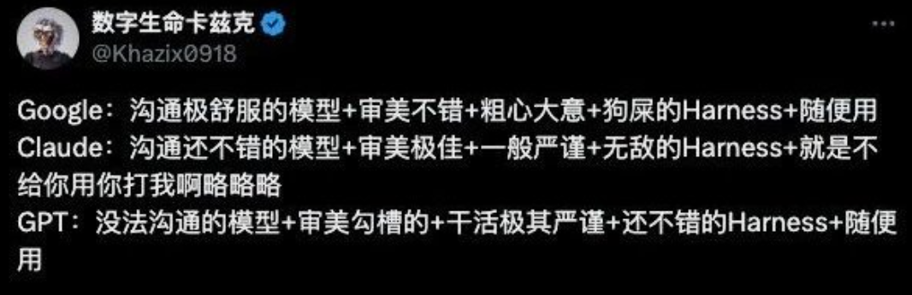
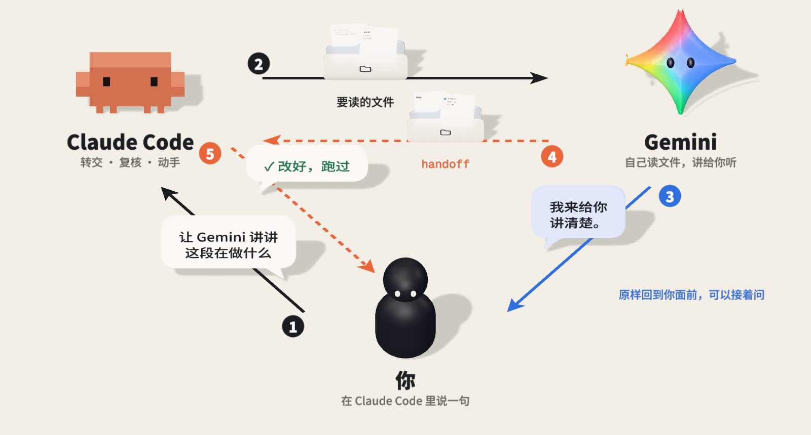

<p align="center">
  <br>
  <sub>这个插件建立在这条判断上：<a href="https://x.com/Khazix0918/status/2124680457623425334">@数字生命卡兹克</a></sub>
</p>

<p align="center">
  <b>Gemini 陪你聊，Claude 把活干完。</b><br>
  一个 Claude Code 插件：把最好聊的 Gemini，放到 Harness 最强的 Claude 身边。<br>
  <a href="assets/claude-x-gemini-film-zh.mp4">▶ 宣传片（26 秒）</a>
</p>

<p align="center">
  <a href="#它是什么"><b>它是什么</b></a> ·
  <a href="#你能得到什么">你能得到什么</a> ·
  <a href="#为什么卡兹克的判断以及我们的不同">为什么</a> ·
  <a href="#安装与运行">安装与运行</a> ·
  <a href="README.md">English</a>
</p>

---

## 它是什么

你照常在 Claude Code 里工作。想让人给你讲清楚一件事、或者聊一个想法时，说一句"问问 Gemini"。Gemini 自己读文件，直接回答**你**。聊清楚之后，Gemini 告诉 Claude 你要什么，Claude 复核后动手。

<p align="center">
  
</p>

这些是工具，不是流水线。Claude 可以只用其中一个、任意顺序、随时停。

| 功能 | 做什么 |
|---|---|
| **讲解** | Claude 只点名文件；Gemini 用自己的额度去读并讲解，回答原样交给你。 |
| **对话** | 追问在同一段对话里继续。Claude 转述你的意思，顺手修正语音输入的错字。 |
| **简报（handoff）** | Gemini 写出你要什么、还没定什么、它自己的建议，三者分开。Claude 复核后动手。 |
| **第二方案** | 大方案时，Gemini 只拿你的原话独立出一份，不看 Claude 的草稿。Claude 合并，并告诉你哪里不同。 |
| **讲解风格** | 默认关闭，你要时才开：`plain`（约 80% 的 ASD-STE100）、`eli5`、`feynman`、`expert`，或 `--html` 交互页面。 |
| **你的语言** | 你和 Claude 用什么语言，Gemini 就用什么语言。任何地方都不写死语言。 |
| **`doctor`** | 检查 `agy`、登录、额度和可用模型，不消耗对话轮次。 |

## 你能得到什么

- **Claude 只花很少的 token。** Gemini 读，Claude 只点名文件。阅读是 agent 最大的开销。
- **Gemini 的原话。** 讲解不经过 Claude 的总结压缩，直接到你手里。
- **复核过的简报。** Gemini 粗心，还说得很笃定。测试中它把峰时说成了半价时段，被 Claude 的复核查了出来。你的原话永远优先于 Gemini 的总结。
- **Gemini 碰不到你的代码。** 它只读。疑似密钥文件被禁止读取；在放入假密钥的诱饵测试中，没有泄露任何值。
- **几乎没有 prompt。** Claude 用自己的话写给 Gemini。固定的句子只有改变过测试结果才保留，最后留下四句：列出你没回答的问题；Gemini 的建议和你的要求分开；只读，并标出推测；用你的语言写。

## 为什么：卡兹克的判断，以及我们的不同

> Gemini = 沟通极舒服的模型 + 审美不错 + 粗心大意 + 狗屎的Harness<br>
> Claude = 沟通还不错的模型 + 审美极佳 + 一般严谨 + 无敌的Harness
>
> —— [@数字生命卡兹克](https://x.com/Khazix0918/status/2124680457623425334)

他的答案是：让 Claude 站中间，Gemini 坐在旁边当军师。这个插件就建立在这个判断上，只让每个模型做它擅长的事：

| | 单独用 Google 的 CLI（`agy`） | Gemini 给 Claude 打工（其他 `agy` 插件） | **claude-x-gemini** |
|---|---|---|---|
| 你和谁说话 | Gemini | Claude | **弄懂时和 Gemini，干活时和 Claude** |
| 谁改文件 | Gemini，在 Gemini 的 Harness 里 | Gemini，需授予写权限 | **只有 Claude** |
| 谁复核结果 | 你自己 | Claude | **Claude，对照你的原话和文件** |
| 带回给 Claude 什么 | 没有，是另一个会话 | 代码、diff、摘要 | **你要什么、还没定什么、Gemini 的建议，分开写** |

- 想让 Gemini 在 Google 的 Harness 里直接干活，**单独用 `agy`**。
- 想在写代码上省 Claude 的 token，用**打工型插件**，比如 [antigravity-for-claude-code](https://github.com/yuting0624/antigravity-for-claude-code)。
- 想和 Gemini 把项目弄懂、把想法聊透，又只让 Claude 碰你的代码，用 **claude-x-gemini**。

## 安装与运行

**1. 安装 Google 的 Antigravity CLI，登录一次**

```bash
brew install --cask antigravity-cli   # Gemini CLI 已不再服务个人账户
agy                                   # 用 Google 账户登录，然后退出
```

**2. 在 Claude Code 里安装插件**

```
/plugin marketplace add pursurer/claude-x-gemini
/plugin install claude-x-gemini@claude-x-gemini
```

不用插件市场：把 `skills/claude-x-gemini/` 复制到 `.claude/skills/`。它自成一体（Python 3.9+，macOS 或 Linux）。

**3. 点名 Gemini**

| 你对 Claude Code 说 | 会发生什么 |
|---|---|
| "让 Gemini 讲讲这个仓库是怎么组织的。" | Gemini 读文件并讲解，回答原样交给你。 |
| "问问 Gemini：为什么不在这里加缓存？" | Claude 转述你的问题，补上 Gemini 缺的背景。 |
| "好，取 Gemini 的简报。" | Gemini 说出你要什么、还没定什么；Claude 复核后动手。 |
| "让 Gemini 也独立出一份方案。" | 两份独立方案；Claude 合并，并告诉你哪里不同。 |

只有你点名 Gemini 时插件才会运行，因为它读到的文件会发给 Google。

**可选：** 在项目根目录放 `.claude-x-gemini.md`（受众、术语、语气），会附在每段话后面。输出存在 `.claude-x-gemini/`（用 `CLAUDE_X_GEMINI_DIR` 修改）。出了问题？运行 `python3 skills/claude-x-gemini/scripts/relay.py doctor`。

## 局限与安全

- Gemini 只读：不能写文件、不能执行命令。它能读工作区里的文件，读到的内容会发给 Google。
- 每次运行前，按精确路径禁止读取疑似密钥文件（`.env*`、私钥、凭据）。Antigravity CLI 1.5.16 的通配符和正则禁止规则在测试中无效。在一次诱饵测试中（agy 1.5.16，2026 年 11 月），我们放入假密钥，让 Gemini 用它所有的工具去找：它没有搜索和列目录工具，读 `.env` 被拒绝，没有泄露任何值。以后的 `agy` 如果加入搜索工具，结果可能改变。
- 能用哪个 Gemini 取决于套餐。2026 年 11 月，学生版 Google AI Pro 在 Antigravity 里只有 Gemini 3.8 Flash；付费 Pro 和 Ultra 可用 Gemini 4 Neon。
- 省 token 的数据来自一个相关项目在编码任务上的实测，不是我们在讲解任务上测的：整件事交出去、主控不读材料，成本约 0.58 倍；逐个文件交出去，成本 1.33–1.68 倍（[antigravity-for-claude-code](https://github.com/yuting0624/antigravity-for-claude-code)）。

## 仓库里有什么

```
.claude-plugin/                  插件与市场清单
skills/claude-x-gemini/          一个自成一体的 skill（Agent Skills 规范）
  SKILL.md                       给 Claude 看的流程
  scripts/relay.py               explain · say · handoff · models · doctor（只用标准库）
  assets/handoff.md              唯一固定发给 Gemini 的要求：一句话
  assets/styles/*.md             可选风格，每个一行
assets/                          主页图片
```

## 致谢

[@数字生命卡兹克](https://x.com/Khazix0918/status/2124680457623425334)：模型画像与"Claude 站中间"的调度思路 · [Andrej Karpathy](https://x.com/karpathy/status/2105819303471976479)：约 80% 的 ASD-STE100 · [understanding-ladder](https://github.com/ChangWenC/understanding-ladder)："不删任何内容" · [antigravity-for-claude-code](https://github.com/yuting0624/antigravity-for-claude-code)：只读 `agy` 设置与实测数据 · 流程图里的 Gemini 和 Claude 标志是各自公司的商标，只用来指代产品 · 宣传片素材：香港城市模型 Jack M Simmons（CC BY）、MacBook 模型 jackbaeten（CC BY），均来自 Sketchfab；高程数据 Terrain Tiles（Mapzen、NASA SRTM） · 仓库结构参考 [Agent Skills 规范](https://agentskills.io/specification)、[anthropics/skills](https://github.com/anthropics/skills)、[obra/superpowers](https://github.com/obra/superpowers)、[mattpocock/skills](https://github.com/mattpocock/skills)。

## 许可

[MIT](LICENSE)
