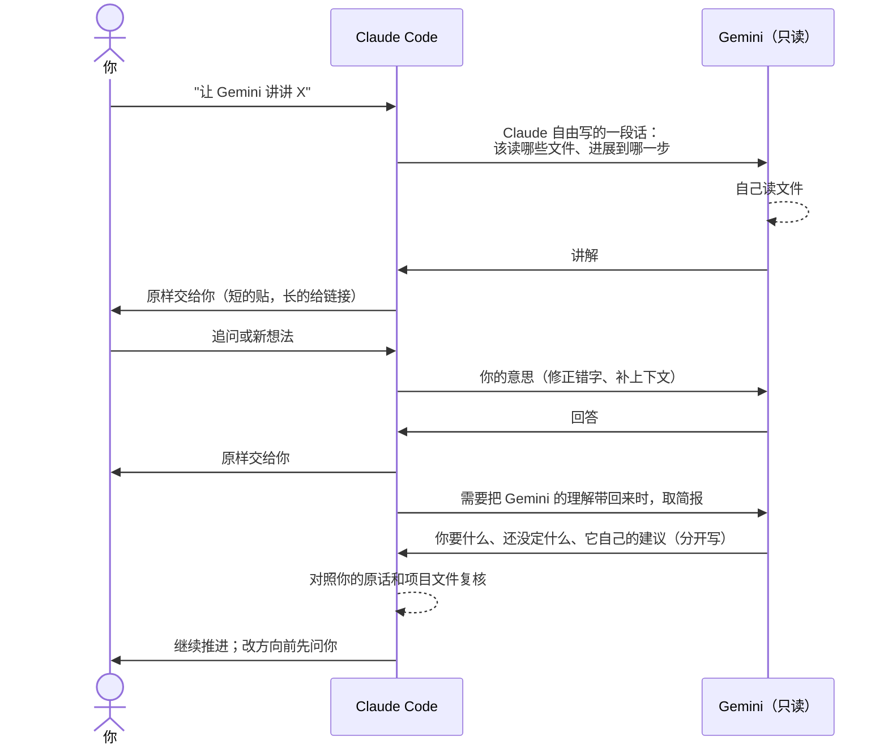

# gemini-relay

**让 Gemini 给你讲懂项目，和它把想法聊清楚，再由 Gemini 把你要什么告诉 Claude Code。**

一个 Claude Code 插件。你始终只在 Claude Code 一个窗口里操作。Gemini 通过
[Antigravity CLI](https://antigravity.google/docs/cli) 自己读文件、讲解，用的是 Google 的额度。

[English](README.md)

## 为什么需要它

1. **理解才是瓶颈。** agent 干完活，你面对的是看不太懂的报告和改动。让另一个模型用新眼光读文件、讲给你听。
2. **阅读最费 Claude 的额度。** 讲懂十几个文件，Claude 就得先读十几个文件。改由 Claude 写一段短话交代"读哪些、进展到哪"，Gemini 用自己的额度去读。
3. **想法传到 agent 那里会走样。** 你边想边说、语音输入、说得不完整，agent 就做偏了。先和 Gemini 聊清楚，再由它告诉 Claude 你要什么、还没定什么，它自己的建议单独写；Claude 对照你的原话复核后再动手。

## 工作方式



三个工具，不是流水线。Claude Code 可以只用其中一个、任意顺序、随时停：

| 工具 | 做什么 |
|---|---|
| **explain 讲解** | Claude 给 Gemini 写一段话，它本来就知道哪些文件要紧、进展到哪。Gemini 自己读文件并讲解，回答原样交给你。 |
| **say 对话** | 你的追问或新想法进入同一个 Gemini 会话。Claude 转述你的意思：修正语音输入的错字，补上 Gemini 不知道的背景。 |
| **handoff 简报** | Gemini 告诉 Claude 你要什么、哪些还没定，它自己的建议单独写。Claude 复核后继续推进。 |

## 安装

需要 Claude Code、Python 3.9+，以及用 Google 账户登录的 Antigravity CLI：

```bash
brew install --cask antigravity-cli   # 或 Google 官方安装方式
agy                                    # 运行一次，完成登录
```

Gemini CLI 已于 2026-06-18 停止服务个人 Google 账户，Antigravity CLI 是它的替代。

在 Claude Code 里：

```
/plugin marketplace add pursurer/gemini-relay
/plugin install gemini-relay@gemini-relay
```

不用插件市场：把 `skills/gemini-relay/` 整个文件夹复制到项目的 `.claude/skills/`（或 `~/.claude/skills/`）。它自成一体。

## 用法

直接对 Claude Code 说：

- "让 Gemini 讲讲登录流程是怎么工作的。"
- "问问 Gemini：为什么不在这里加缓存？"
- "我想和 Gemini 聊聊这个想法。"……"好，取 Gemini 的简报。"

讲解风格默认关闭，你要求时 Claude 才加：`plain`（约 80% 的 ASD-STE100，不删任何事实）、`eli5`、`feynman`、`expert`，或 `--html` 输出交互式页面。自定义风格：在 `skills/gemini-relay/assets/styles/` 里加一个文件，写一行即可。

项目默认要求（受众、要避开的术语、语气）写在项目根目录的 `.gemini-relay.md`，会附在每段话后面。

## 设计取舍

- **Claude 自由写，不教 Gemini 怎么说话。** 没有固定的任务说明模板。一次小规模盲评（一个题目、一位读者）中，自由写胜过固定 5 项模板。
- **每句固定文字都要证明自己有用。** 测试中没有改变结果的句子都删掉了。只留下三句：列出没得到回答的问题；建议和你的要求分开；只读。
- **Claude 先复核再推进。** Gemini 可能错得很自信：测试中它把峰时说成了半价时段，被复核查了出来。你的原话永远优先于 Gemini 的总结。
- **为什么把阅读交给 Gemini。** 阅读最费 agent 的额度。相关项目在编码任务上测过：整件事交出去、主控不读材料，成本约 0.58 倍；逐个文件交出去，成本 1.33–1.68 倍。我们按前一种做，讲解场景下省多少还没自己测过。

## 局限与安全

- Gemini 只读运行，不能写文件、不能执行命令；它能读工作区里的文件，这些内容会发给 Google。
- 每次运行前，脚本按精确路径禁止读取疑似密钥文件（`.env*`、私钥、凭据）。Antigravity CLI 1.5.16 的通配符和正则禁止规则在测试中无效。搜索工具没有测过。
- 能用哪个 Gemini 取决于你的套餐。2026-11 时，学生版 Google AI Pro 在 Antigravity 里只有 Gemini 3.8 Flash；付费 Pro 和 Ultra 可用 Gemini 4 Neon。

## 许可

MIT
