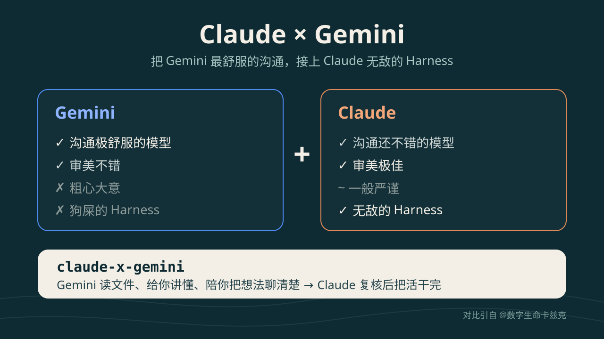
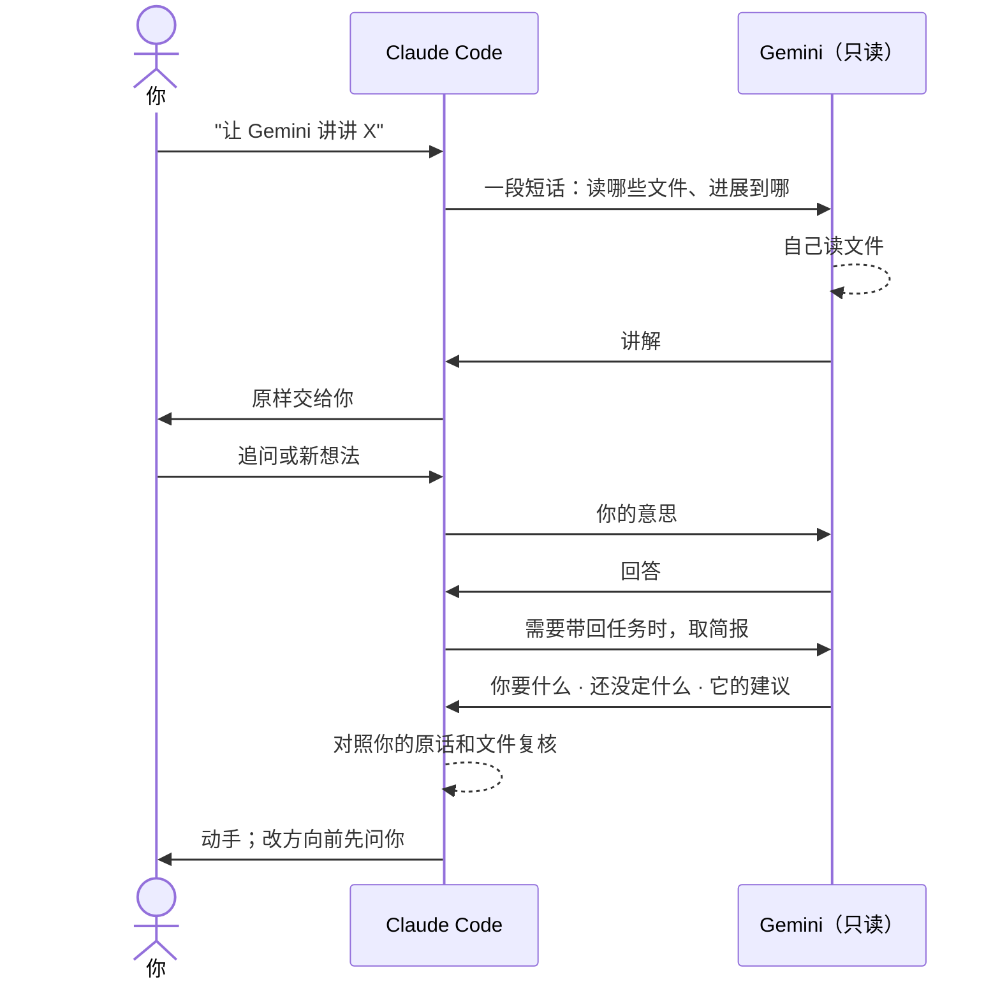

<p align="center">
  
</p>

<p align="center">
  <b>Gemini 陪你聊，Claude 把活干完。</b><br>
  一个 Claude Code 插件：把最好聊的 Gemini，放到 Harness 最强的 Claude 身边。
</p>

<p align="center">
  <a href="#30-秒安装"><b>30 秒安装</b></a> ·
  <a href="#你可以这样说">你可以这样说</a> ·
  <a href="#工作方式">工作方式</a> ·
  <a href="README.md">English</a>
</p>

---

> Gemini = 沟通极舒服的模型 + 审美不错 + 粗心大意 + 狗屎的Harness<br>
> Claude = 沟通还不错的模型 + 审美极佳 + 一般严谨 + 无敌的Harness
>
> —— [@数字生命卡兹克](https://x.com/Khazix0918/status/2124680457623425334)。他的答案是：让 Claude 站中间，Gemini 坐在旁边当军师。这个插件把这个答案装进了 Claude Code。

## 30 秒安装

```bash
brew install --cask antigravity-cli   # Google 的 Antigravity CLI（Gemini CLI 已不再服务个人账户）
agy                                   # 运行一次，用 Google 账户登录
```

然后在 Claude Code 里：

```
/plugin marketplace add pursurer/claude-x-gemini
/plugin install claude-x-gemini@claude-x-gemini
```

不用插件市场：把 `skills/claude-x-gemini/` 复制到 `.claude/skills/`。它自成一体（Python 3.9+，macOS 或 Linux）。

## 你可以这样说

| 你对 Claude Code 说 | 会发生什么 |
|---|---|
| "让 Gemini 讲讲这个仓库是怎么组织的。" | Claude 只点名文件，**Gemini 用它自己的额度去读**并讲解，回答原样交给你。 |
| "问问 Gemini：为什么不在这里加缓存？" | Claude 转述你的意思：修正语音输入的错字、补上背景，再交给 Gemini 回答。 |
| "好，取 Gemini 的简报。" | Gemini 说出你要什么、还没定什么、它自己的建议（分开写）。**Claude 对照你的原话和代码复核**，然后动手。 |
| "让 Gemini 也独立出一份方案。" | Claude 出一份；Gemini 只拿你的原话和必要背景，独立出一份。Claude 合并，并告诉你哪里一致、哪里不同。 |

它用你的语言回答。讲解风格默认关闭，你要时才开：`plain`（约 80% 的 ASD-STE100）、`eli5`、`feynman`、`expert`，或 `--html` 交互式页面。

## 工作方式



这些是工具，不是流水线。Claude 可以只用其中一个、任意顺序、随时停。

## 为什么这样设计

- **Gemini 读，Claude 不读。** 阅读最费 agent 的额度，所以 Claude 只点名文件。相关项目在编码任务上测过：整件事交出去、主控不读材料，成本约 0.58 倍；逐个文件交出去，成本 1.33–1.68 倍（[antigravity-for-claude-code](https://github.com/yuting0624/antigravity-for-claude-code)）。
- **Claude 先复核再动手。** Gemini 粗心，还说得很笃定。测试中它把峰时说成了半价时段，被 Claude 的复核查了出来。你的原话永远优先于 Gemini 的总结。
- **几乎没有 prompt。** Claude 用自己的话写给 Gemini，不教 Gemini 怎么说话。一次小规模盲评（一个题目、一位读者）中，这种写法胜过固定 5 项模板。固定的句子只有改变过测试结果才保留，最后留下三句：列出你没回答的问题；Gemini 的建议和你的要求分开；只读，并标出推测。

## 仓库里有什么

```
.claude-plugin/                  插件与市场清单
skills/claude-x-gemini/          一个自成一体的 skill（Agent Skills 规范）
  SKILL.md                       给 Claude 看的流程（60 行）
  scripts/relay.py               explain · say · handoff · models（只用标准库）
  assets/handoff.md              唯一固定发给 Gemini 的要求：一句话
  assets/styles/*.md             可选风格，每个一行
assets/                          主页图片
```

项目默认要求（受众、术语、语气）写在项目根目录的 `.claude-x-gemini.md`，会附在每段话后面。输出存在 `.claude-x-gemini/`（用 `CLAUDE_X_GEMINI_DIR` 修改）。

## 局限与安全

- Gemini 只读：不能写文件、不能执行命令。它能读工作区里的文件，读到的内容会发给 Google。
- 每次运行前，按精确路径禁止读取疑似密钥文件（`.env*`、私钥、凭据）。Antigravity CLI 1.5.16 的通配符和正则禁止规则在测试中无效。搜索工具没有测过。
- 能用哪个 Gemini 取决于套餐。2026 年 11 月，学生版 Google AI Pro 在 Antigravity 里只有 Gemini 3.8 Flash；付费 Pro 和 Ultra 可用 Gemini 4 Neon。

## 致谢

[@数字生命卡兹克](https://x.com/Khazix0918/status/2124680457623425334)：模型画像与"Claude 站中间"的调度思路 · [Andrej Karpathy](https://x.com/karpathy/status/2105819303471976479)：约 80% 的 ASD-STE100 · [understanding-ladder](https://github.com/ChangWenC/understanding-ladder)："不删任何内容" · [antigravity-for-claude-code](https://github.com/yuting0624/antigravity-for-claude-code)：只读 `agy` 设置与实测数据 · 仓库结构参考 [Agent Skills 规范](https://agentskills.io/specification)、[anthropics/skills](https://github.com/anthropics/skills)、[obra/superpowers](https://github.com/obra/superpowers)、[mattpocock/skills](https://github.com/mattpocock/skills)。

## 许可

[MIT](LICENSE)
